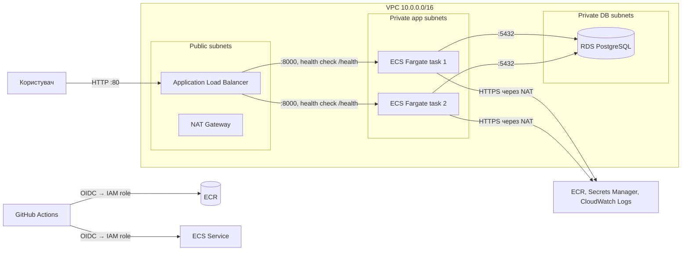

# Tasks API — лабораторні роботи 1 і 2 з хмарних технологій

REST API для списку задач (to-do) з реєстрацією та JWT-автентифікацією.
Запакований у Docker, розгорнутий в **AWS** (ECS Fargate + RDS PostgreSQL за Application Load Balancer),
уся інфраструктура описана в **Terraform**, тести й перевірка Terraform запускаються в **GitHub Actions**.

**Публічна адреса:** http://tasks-api-alb-698321018.eu-north-1.elb.amazonaws.com
**Swagger UI:** http://tasks-api-alb-698321018.eu-north-1.elb.amazonaws.com/docs

## Стек

| Шар | Технологія |
|---|---|
| Застосунок | Python 3.13, FastAPI, SQLAlchemy 2, PostgreSQL 16, PyJWT + bcrypt |
| Контейнер | Docker (multi-stage, `python:3.13.9-slim-bookworm`, non-root), Docker Compose |
| Хмара | AWS: VPC, ALB, ECS Fargate, ECR, RDS PostgreSQL, Secrets Manager, CloudWatch, SNS, Budgets |
| IaC | Terraform ≥ 1.11, AWS provider ~> 6.62 |
| CI/CD | GitHub Actions + OIDC-роль IAM |

## Архітектура



- З інтернету видно **лише ALB**. Контейнери в приватних підмережах без публічних IP.
- Security groups утворюють ланцюжок `ALB → App → DB`: кожен рівень пускає трафік **лише від security group попереднього**, а не від IP-діапазонів.
- База в приватних підмережах без маршруту в інтернет, `publicly_accessible = false`.
- Пароль бази генерує RDS і зберігає в Secrets Manager; ECS підставляє його в змінну середовища `DB_PASSWORD` при старті контейнера. Пароля немає ні в коді, ні в образі, ні в `tfvars`, ні в Terraform state.

## Ендпоінти

| Метод | Шлях | Опис | Авторизація |
|---|---|---|---|
| GET | `/` | Інформація про сервіс і версію | — |
| GET | `/health` | Health check (застосунок + база) | — |
| GET | `/docs` | Swagger UI (OpenAPI: `/openapi.json`) | — |
| POST | `/auth/register` | Реєстрація `{username, password}` | — |
| POST | `/auth/login` | Логін (form: `username`, `password`) → JWT | — |
| GET | `/auth/me` | Поточний користувач | JWT |
| GET | `/tasks?done=true` | Список своїх задач | JWT |
| POST | `/tasks` | Створити задачу `{title, description}` | JWT |
| GET | `/tasks/{id}` | Отримати задачу | JWT |
| PATCH | `/tasks/{id}` | Змінити `{title?, description?, done?}` | JWT |
| DELETE | `/tasks/{id}` | Видалити задачу | JWT |

Без токена захищені ендпоінти повертають **401**.

## Структура проєкту

```
.
├── app/
│   ├── app/
│   │   ├── main.py
│   │   ├── config.py
│   │   ├── database.py
│   │   ├── models.py
│   │   ├── schemas.py
│   │   ├── security.py
│   │   ├── dbshell.py
│   │   └── routers/
│   ├── tests/test_api.py
│   ├── Dockerfile
│   ├── requirements.txt
│   └── requirements-dev.txt
├── infra/
│   ├── autoscaling.tf
│   ├── idempotency.tf
│   ├── queue.tf
│   ├── versions.tf
│   ├── variables.tf / outputs.tf
│   ├── terraform.tfvars.example
│   ├── budget.tf
│   ├── network.tf
│   ├── security_groups.tf
│   ├── ecr.tf
│   ├── rds.tf
│   ├── secrets.tf
│   ├── iam.tf
│   ├── ecs.tf
│   ├── alb.tf
│   ├── github_oidc.tf
│   └── monitoring.tf
├── docs/
├── loadtest/
├── .github/workflows/deploy.yml
├── compose.yaml
└── .env.example
```

## Локальний запуск (завдання 1)

Потрібен Docker. Створи `.env` зі зразка та задай власні значення перед запуском.

```bash
cp -n .env.example .env
```

Після редагування `.env` виконай:

```bash
docker compose up --build
```

Відкрийте http://localhost:8000/docs. Дані бази лежать у volume `pgdata` і переживають `docker compose down`
(видаляються лише через `docker compose down -v`).

Тести: `cd app && pip install -r requirements-dev.txt && python -m pytest` (потрібна запущена PostgreSQL і змінні `DB_*`, `JWT_SECRET`).

## Розгортання в AWS (завдання 2–7)

Для нового розгортання з кореня репозиторію створи локальний `infra/terraform.tfvars` зі зразка, якщо файла ще немає.

```bash
cp -n infra/terraform.tfvars.example infra/terraform.tfvars
```

У `infra/terraform.tfvars` введи свою адресу для сповіщень і `github_repo = "Kseniia-oss/cloud-lab1"`. Потім виконай:

```bash
terraform -chdir=infra init
terraform -chdir=infra apply -target=aws_budgets_budget.monthly
terraform -chdir=infra apply
```

Доступ до AWS з терміналу — через `aws login` (тимчасові облікові дані на 12 годин, без довготривалих ключів).

### Деплой застосунку

Образ збирається локально і завантажується в ECR, після чого ECS перезапускає задачі з новим образом
(rolling update: нові задачі стартують, проходять health check, і лише потім зупиняються старі):

```bash
ecr_uri="$(terraform -chdir=infra output -raw ecr_repository_url)"
aws ecr get-login-password --region eu-north-1 | docker login --username AWS --password-stdin "${ecr_uri%%/*}"
docker build --platform linux/amd64 -t "$ecr_uri:bootstrap" app
docker push "$ecr_uri:bootstrap"
aws ecs update-service --region eu-north-1 --cluster tasks-api --service tasks-api --force-new-deployment
```

Видалення всього: `terraform destroy`.

## CI/CD (завдання 5)

`.github/workflows/deploy.yml` на кожен push у `main`:

1. **test** — pytest проти справжньої PostgreSQL (service container).
2. **terraform** — `fmt -check` і `validate`.
3. **deploy** — підготовлений, але **не запускається**.

Акаунт створено через новий режим реєстрації AWS (проєкти, Free plan). Service control policy цього режиму
(`DenyIAMRestrictedActions`) забороняє `iam:*Provider*`, тому OIDC-провайдер для GitHub створити неможливо,
а зберігати довготривалі ключі AWS у GitHub небезпечно. Тому деплой виконується вручну (команди вище).

Код OIDC збережено в `infra/github_oidc.tf` за перемикачем `enable_github_oidc` (за замовчуванням `false`).
Після переходу на Paid plan і активації advanced features достатньо `enable_github_oidc = true` у `terraform.tfvars`,
`terraform apply` і змінної `AWS_ROLE_ARN` у GitHub — і job **deploy** почне працювати: OIDC → тимчасові
облікові дані ролі → збірка образу з тегом = хеш коміту → push в ECR → нова ревізія task definition → оновлення ECS.

Захист від невдалого релізу: ECS deployment circuit breaker відкочує версію, яка не проходить health check.

## Моніторинг (завдання 7)

- Логи контейнерів → CloudWatch Logs, група `/ecs/tasks-api` (один рядок на запит: метод, шлях, статус, тривалість).
- Дашборд `tasks-api` (посилання — вихід `dashboard_url`): запити, 5xx, латентність p50/p95/p99, CPU/пам'ять ECS, здорові екземпляри, RDS, останні помилки з логів.
- Алерти на email через SNS: ≥ 5 помилок 5xx за 5 хв; немає здорових екземплярів за ALB.
- AWS Budget: лист при 50% фактичних витрат і при прогнозі > 100%.

## Відповідність вимогам

| Завдання | Де реалізовано |
|---|---|
| 1. Контейнер | `app/Dockerfile` (зафіксований тег, залежності окремим шаром, `USER app`), `compose.yaml` (volume `pgdata`) |
| 2. Terraform | `infra/*.tf`: ECR, RDS, ECS Fargate; підключення до бази — env + Secrets Manager |
| 3. Мережева ізоляція | `network.tf`, `security_groups.tf`, `rds.tf` (`publicly_accessible = false`) |
| 4. Load balancer | `alb.tf` (health check `/health`), контейнери без публічних IP |
| 5. CD | CI в `.github/workflows/deploy.yml`; деплой вручну (OIDC заблоковано SCP, код у `github_oidc.tf`) |
| 6. Безпека доступу | JWT (`app/app/security.py`), 401 без токена, ключ підпису в Secrets Manager |
| 7. Моніторинг | `monitoring.tf`, логи в `ecs.tf` |
| 8. Документація API | Swagger UI на `/docs` |

## Вартість

Приблизно $2–3 на добу, поки інфраструктура працює: NAT Gateway (~$1.1), ALB (~$0.6), 2 задачі Fargate (~$0.6), публічні IPv4,
RDS `db.t4g.micro` (Free Tier / кредити). **Після захисту — `terraform destroy`.**

## Лабораторна робота 2

- [Масштабування та панель CloudWatch](docs/AUTOSCALING.md)
- [Навантажувальний сценарій і результати](docs/LOADTEST.md)
- [Сповіщення CloudWatch / SNS](docs/ALERTS.md)
- [Кешування списку задач](docs/CACHE.md)
- [Бонус — асинхронна черга SQS](docs/QUEUE.md)
- [Бонус — ідемпотентність POST](docs/IDEMPOTENCY.md)
- [Бонус — розклад і розрахунок економії](docs/SCHEDULE.md)

### 1. Папка проєкту і Terraform state

На Windows відкрий **Git Bash** у попередній папці `cloud-lab1`. Скопіюй туди вміст папки з архіву, включно з `.github`. Збережи свій каталог `.git`, локальні налаштування та state лабораторної №1. Потрібні встановлені Git, Docker Desktop, AWS CLI, Terraform і k6.

```bash
git status --short
aws sts get-caller-identity
terraform -chdir=infra init -input=false
terraform -chdir=infra validate
terraform -chdir=infra state list
```

Якщо AWS CLI просить авторизацію, увійди тим самим способом і в той самий акаунт, яким користувалася в лабораторній №1. У state наявного розгортання мають бути `aws_ecs_service.app` та `aws_ecr_repository.app`. Якщо state порожній, а ресурс ECS із лабораторної №1 ще існує, спочатку знайди й підключи оригінальний state. Якщо інфраструктуру й state вже видалено, віднови базові ресурси за розділом AWS лабораторної №1.

Перед збіркою образу можна зафіксувати код локальним комітом. Push можна зробити одразу для CI або після додавання результатів.

### 2. Образ і деплой без кешу

У Git Bash із кореня репозиторію виконай наступний блок. Значення збережуться в поточній вкладці Git Bash.

```bash
ecr_uri="$(terraform -chdir=infra output -raw ecr_repository_url)"
image_tag="lab2-$(git rev-parse --short HEAD)-$(date -u +%Y%m%d%H%M%S)"
aws ecr get-login-password --region eu-north-1 | docker login --username AWS --password-stdin "${ecr_uri%%/*}"
docker build --platform linux/amd64 -t "$ecr_uri:$image_tag" app
docker push "$ecr_uri:$image_tag"
```

Підготуй план і перевір заплановані зміни. Прапорці трьох бонусів вимкнені на час основного порівняння.

```bash
common_vars=(-var="image_tag=$image_tag" -var=enable_scheduled_scaling=false -var=enable_task_queue=false -var=enable_idempotency=false)
terraform -chdir=infra plan "${common_vars[@]}" -var=tasks_cache_enabled=false -out=lab2.tfplan
```

Після перевірки плану виконай цей блок:

```bash
activate_lab2() {
  local revision
  revision="$(terraform -chdir=infra output -raw app_task_definition_arn)" || return
  aws ecs update-service --region eu-north-1 --cluster tasks-api --service tasks-api --task-definition "$revision" --query service.taskDefinition &&
  aws ecs wait services-stable --region eu-north-1 --cluster tasks-api --services tasks-api &&
  aws ecs describe-services --region eu-north-1 --cluster tasks-api --services tasks-api --query 'services[0].[taskDefinition,desiredCount,runningCount]' --output table
}

terraform -chdir=infra apply lab2.tfplan && activate_lab2
app_url="$(terraform -chdir=infra output -raw app_url)"
curl -fsS "$app_url/health"
terraform -chdir=infra output -raw dashboard_url
```

Після активації звір ревізію в таблиці з виводом `terraform -chdir=infra output -raw app_task_definition_arn`. Terraform зберігає потрібну ревізію, а ECS активує її окремою командою для сумісності з CI/CD лабораторної №1. У консолі SNS перевір статус email-підписки й натисни **Confirm subscription** у листі, якщо статус ще `Pending confirmation`. У ECS дочекайся, щоб у сервісу були `Desired tasks = 1` і `Running tasks = 1`.

### 3. Два хмарні прогони

Почни з 40 віртуальних користувачів. `SMOKE=1` перевіряє контракт двома короткими ітераціями. Повноцінний тест триває приблизно 10 хвилин.

```bash
vus=40
BASE_URL="$app_url" CACHE_MODE=off SMOKE=1 k6 run loadtest/tasks.js
BASE_URL="$app_url" CACHE_MODE=off VUS="$vus" k6 run loadtest/tasks.js
```

Після спаду навантаження дочекайся повернення ECS до одного завдання. На CloudWatch зафіксуй початок прогону, перетин 60% CPU, появу та вилучення завдання. Для листів `ALARM` і `OK` потрібен прогін, під час якого ECS досяг максимуму в 3. Якщо цього не сталося, повтори тест із дещо більшим `vus` після повернення до одного завдання. Для фінального порівняння з кешем використовуй те саме `vus`, що й у відповідному прогоні без кешу.

Увімкни кеш тим самим образом:

```bash
terraform -chdir=infra plan "${common_vars[@]}" -var=tasks_cache_enabled=true -out=lab2.tfplan
```

Після перевірки плану застосуй його та звір активну ревізію:

```bash
terraform -chdir=infra apply lab2.tfplan && activate_lab2
```

Дочекайся стану `Desired = Running = 1` і повтори той самий тест:

```bash
BASE_URL="$app_url" CACHE_MODE=on SMOKE=1 k6 run loadtest/tasks.js
BASE_URL="$app_url" CACHE_MODE=on VUS="$vus" k6 run loadtest/tasks.js
```

Після завершення знову перевір повернення до одного завдання. Файли `loadtest/results-off.json` та `loadtest/results-on.json` створить k6. Перенеси числа у [звіт тестування](docs/LOADTEST.md) і [порівняння кешу](docs/CACHE.md). Для порівняння RDS візьми CPU та ReadIOPS за однакові п’ятихвилинні фази. Збережи скриншоти в `docs/evidence/` і встав їх у [звіт масштабування](docs/AUTOSCALING.md) та [звіт про сповіщення](docs/ALERTS.md). На знімках листів приховай особисту адресу.

### 4. Бонусні завдання

Після основних вимірювань підготуй план із тим самим образом. Керований Redis має окрему вартість.

```bash
terraform -chdir=infra plan -var="image_tag=$image_tag" -var=tasks_cache_enabled=false -var=enable_task_queue=true -var=enable_idempotency=true -var=enable_scheduled_scaling=false -out=lab2-bonus.tfplan
```

Після перевірки плану активуй ревізію:

```bash
terraform -chdir=infra apply lab2-bonus.tfplan && activate_lab2
```

Виконай [перевірку SQS](docs/QUEUE.md) та [перевірку ідемпотентності](docs/IDEMPOTENCY.md) і збережи докази. Розклад увімкни, повторивши бонусний план і застосування з `-var=enable_scheduled_scaling=true`, коли експерименти з поверненням до мінімуму 1 вже завершено. [Розклад і розрахунок економії](docs/SCHEDULE.md).

Якщо після вимкнення розкладу мінімум залишився на 2, поверни його до 1:

```bash
aws application-autoscaling register-scalable-target --region eu-north-1 \
  --service-namespace ecs --resource-id service/tasks-api/tasks-api \
  --scalable-dimension ecs:service:DesiredCount --min-capacity 1 --max-capacity 3
```

### 5. GitHub і захист

Додай файли до того самого репозиторію, в якому здавала лабораторну №1. Якщо вже є локальний коміт із кодом, цей коміт додасть лише нові результати й документацію.

```bash
git branch --show-current
git add -A
git diff --cached --name-only
git commit -m "Complete cloud lab 2"
git push origin main
```

Перед комітом перевір список файлів. Локальні `.env`, `terraform.tfvars`, state, Terraform plan і AWS-облікові дані мають залишитися на твоєму комп’ютері. Якщо поточна гілка відрізняється від `main`, спочатку інтегруй свої зміни у `main`. На GitHub перевір новий коміт, вкладку **Actions**, каталоги `docs/` і `loadtest/`. Викладачу надішли посилання на той самий репозиторій. Після особистого захисту видали ресурси за вимогою методички через `terraform -chdir=infra destroy`, переглянувши план видалення.
