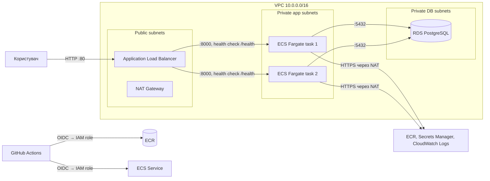

# Tasks API — лабораторна робота 1 з хмарних технологій

REST API для списку задач (to-do) з реєстрацією та JWT-автентифікацією.
Запакований у Docker, розгорнутий в **AWS** (ECS Fargate + RDS PostgreSQL за Application Load Balancer),
уся інфраструктура описана в **Terraform**, тести й перевірка Terraform запускаються в **GitHub Actions**.

**Публічна адреса:** http://tasks-api-alb-698321018.eu-north-1.elb.amazonaws.com
**Swagger UI:** http://tasks-api-alb-698321018.eu-north-1.elb.amazonaws.com/docs

## Стек

| Шар | Технологія |
|---|---|
| Застосунок | Python 3.13, FastAPI, SQLAlchemy 2, PostgreSQL 16, PyJWT + bcrypt |
| Контейнер | Docker (multi-stage, `python:3.13.9-slim-bookworm`, non-root), Docker Compose |
| Хмара | AWS: VPC, ALB, ECS Fargate, ECR, RDS PostgreSQL, Secrets Manager, CloudWatch, SNS, Budgets |
| IaC | Terraform ≥ 1.11, AWS provider ~> 6.62 |
| CI/CD | GitHub Actions + OIDC-роль IAM |

## Архітектура



- З інтернету видно **лише ALB**. Контейнери в приватних підмережах без публічних IP.
- Security groups утворюють ланцюжок `ALB → App → DB`: кожен рівень пускає трафік **лише від security group попереднього**, а не від IP-діапазонів.
- База в приватних підмережах без маршруту в інтернет, `publicly_accessible = false`.
- Пароль бази генерує RDS і зберігає в Secrets Manager; ECS підставляє його в змінну середовища `DB_PASSWORD` при старті контейнера. Пароля немає ні в коді, ні в образі, ні в `tfvars`, ні в Terraform state.

## Ендпоінти

| Метод | Шлях | Опис | Авторизація |
|---|---|---|---|
| GET | `/` | Інформація про сервіс і версію | — |
| GET | `/health` | Health check (застосунок + база) | — |
| GET | `/docs` | Swagger UI (OpenAPI: `/openapi.json`) | — |
| POST | `/auth/register` | Реєстрація `{username, password}` | — |
| POST | `/auth/login` | Логін (form: `username`, `password`) → JWT | — |
| GET | `/auth/me` | Поточний користувач | JWT |
| GET | `/tasks?done=true` | Список своїх задач | JWT |
| POST | `/tasks` | Створити задачу `{title, description}` | JWT |
| GET | `/tasks/{id}` | Отримати задачу | JWT |
| PATCH | `/tasks/{id}` | Змінити `{title?, description?, done?}` | JWT |
| DELETE | `/tasks/{id}` | Видалити задачу | JWT |

Без токена захищені ендпоінти повертають **401**.

## Структура проєкту

```
.
├── app/                          # Застосунок
│   ├── app/
│   │   ├── main.py               # FastAPI: /, /health, логування запитів
│   │   ├── config.py             # Налаштування зі змінних середовища
│   │   ├── database.py           # Підключення до PostgreSQL, створення таблиць
│   │   ├── models.py             # Таблиці users, tasks
│   │   ├── schemas.py            # Pydantic-схеми запитів/відповідей
│   │   ├── security.py           # bcrypt + видача та перевірка JWT
│   │   ├── dbshell.py            # Показати дані в базі (через ECS Exec)
│   │   └── routers/              # /auth і /tasks
│   ├── tests/test_api.py         # Інтеграційні тести (pytest)
│   ├── Dockerfile
│   ├── requirements.txt
│   └── requirements-dev.txt
├── infra/                        # Terraform
│   ├── versions.tf               # Провайдери, регіон, теги
│   ├── variables.tf / outputs.tf
│   ├── terraform.tfvars.example  # Шаблон (сам terraform.tfvars у .gitignore)
│   ├── budget.tf                 # AWS Budget з email-сповіщеннями
│   ├── network.tf                # VPC, підмережі, IGW, NAT, маршрути
│   ├── security_groups.tf        # ALB → App → DB
│   ├── ecr.tf                    # Приватний реєстр образів
│   ├── rds.tf                    # PostgreSQL + керований пароль
│   ├── secrets.tf                # Ключ підпису JWT у Secrets Manager
│   ├── iam.tf                    # Ролі ECS (execution / task)
│   ├── ecs.tf                    # Кластер, task definition, сервіс, логи
│   ├── alb.tf                    # Load balancer, target group, health check
│   ├── github_oidc.tf            # OIDC для GitHub Actions (вимкнено, див. «CI/CD»)
│   └── monitoring.tf             # Дашборд, алерти, SNS → email
├── .github/workflows/deploy.yml  # CI/CD
├── compose.yaml                  # Локальний запуск: app + PostgreSQL
└── .env.example                  # Шаблон локальних змінних (.env у .gitignore)
```

## Локальний запуск (завдання 1)

Потрібен лише Docker.

```bash
cp .env.example .env        # один раз; впишіть свої паролі
docker compose up --build   # застосунок + PostgreSQL
```

Відкрийте http://localhost:8000/docs. Дані бази лежать у volume `pgdata` і переживають `docker compose down`
(видаляються лише через `docker compose down -v`).

Тести: `cd app && pip install -r requirements-dev.txt && python -m pytest` (потрібна запущена PostgreSQL і змінні `DB_*`, `JWT_SECRET`).

## Розгортання в AWS (завдання 2–7)

Коротко:

```bash
cd infra
cp terraform.tfvars.example terraform.tfvars   # email і owner/repo
terraform init
terraform apply -target=aws_budgets_budget.monthly   # бюджет — першим
terraform apply                                       # уся інфраструктура
```

Доступ до AWS з терміналу — через `aws login` (тимчасові облікові дані на 12 годин, без довготривалих ключів).

### Деплой застосунку

Образ збирається локально і завантажується в ECR, після чого ECS перезапускає задачі з новим образом
(rolling update: нові задачі стартують, проходять health check, і лише потім зупиняються старі):

```bash
ECR=401844780186.dkr.ecr.eu-north-1.amazonaws.com
aws ecr get-login-password --region eu-north-1 | docker login --username AWS --password-stdin $ECR
docker build --platform linux/amd64 -t $ECR/tasks-api:bootstrap ./app
docker push $ECR/tasks-api:bootstrap
aws ecs update-service --cluster tasks-api --service tasks-api --force-new-deployment
```

Видалення всього: `terraform destroy`.

## CI/CD (завдання 5)

`.github/workflows/deploy.yml` на кожен push у `main`:

1. **test** — pytest проти справжньої PostgreSQL (service container).
2. **terraform** — `fmt -check` і `validate`.
3. **deploy** — підготовлений, але **не запускається**.

Акаунт створено через новий режим реєстрації AWS (проєкти, Free plan). Service control policy цього режиму
(`DenyIAMRestrictedActions`) забороняє `iam:*Provider*`, тому OIDC-провайдер для GitHub створити неможливо,
а зберігати довготривалі ключі AWS у GitHub небезпечно. Тому деплой виконується вручну (команди вище).

Код OIDC збережено в `infra/github_oidc.tf` за перемикачем `enable_github_oidc` (за замовчуванням `false`).
Після переходу на Paid plan і активації advanced features достатньо `enable_github_oidc = true` у `terraform.tfvars`,
`terraform apply` і змінної `AWS_ROLE_ARN` у GitHub — і job **deploy** почне працювати: OIDC → тимчасові
облікові дані ролі → збірка образу з тегом = хеш коміту → push в ECR → нова ревізія task definition → оновлення ECS.

Захист від невдалого релізу: ECS deployment circuit breaker відкочує версію, яка не проходить health check.

## Моніторинг (завдання 7)

- Логи контейнерів → CloudWatch Logs, група `/ecs/tasks-api` (один рядок на запит: метод, шлях, статус, тривалість).
- Дашборд `tasks-api` (посилання — вихід `dashboard_url`): запити, 5xx, латентність p50/p95/p99, CPU/пам'ять ECS, здорові екземпляри, RDS, останні помилки з логів.
- Алерти на email через SNS: ≥ 5 помилок 5xx за 5 хв; немає здорових екземплярів за ALB.
- AWS Budget: лист при 50% фактичних витрат і при прогнозі > 100%.

## Відповідність вимогам

| Завдання | Де реалізовано |
|---|---|
| 1. Контейнер | `app/Dockerfile` (зафіксований тег, залежності окремим шаром, `USER app`), `compose.yaml` (volume `pgdata`) |
| 2. Terraform | `infra/*.tf`: ECR, RDS, ECS Fargate; підключення до бази — env + Secrets Manager |
| 3. Мережева ізоляція | `network.tf`, `security_groups.tf`, `rds.tf` (`publicly_accessible = false`) |
| 4. Load balancer | `alb.tf` (health check `/health`), контейнери без публічних IP |
| 5. CD | CI в `.github/workflows/deploy.yml`; деплой вручну (OIDC заблоковано SCP, код у `github_oidc.tf`) |
| 6. Безпека доступу | JWT (`app/app/security.py`), 401 без токена, ключ підпису в Secrets Manager |
| 7. Моніторинг | `monitoring.tf`, логи в `ecs.tf` |
| 8. Документація API | Swagger UI на `/docs` |

## Вартість

Приблизно $2–3 на добу, поки інфраструктура працює: NAT Gateway (~$1.1), ALB (~$0.6), 2 задачі Fargate (~$0.6), публічні IPv4,
RDS `db.t4g.micro` (Free Tier / кредити). **Після захисту — `terraform destroy`.**
